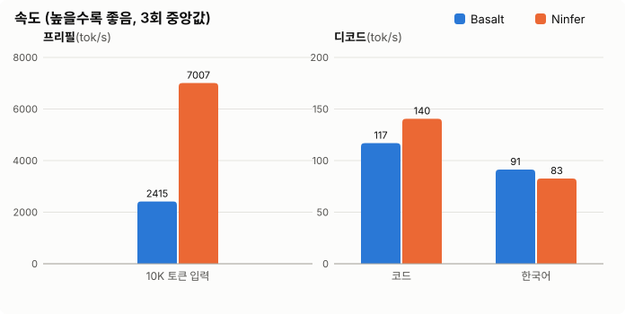
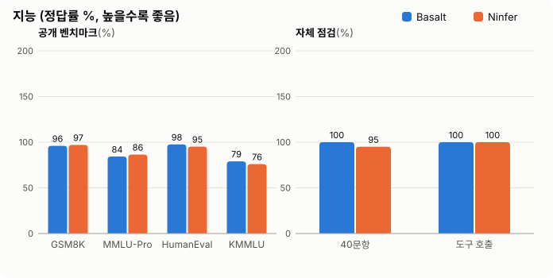
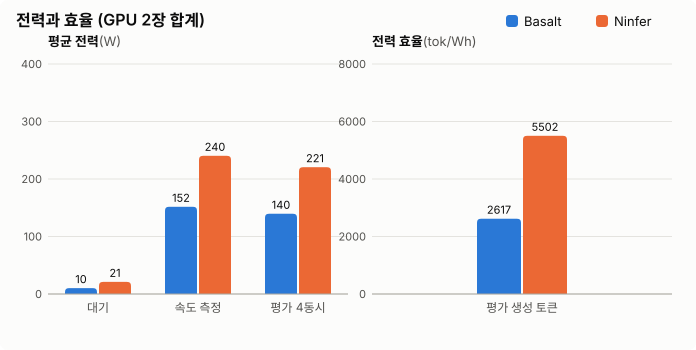
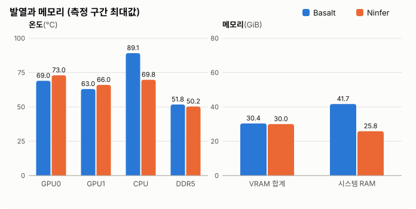

# Basalt vs Ninfer: RTX 5060 Ti 16GB 두 장에서 로컬 LLM 엔진 비교

RTX 5060 Ti 16GB 두 장(P2P 없음)으로 로컬 LLM을 돌리는 PC에서 엔진 두 개를 비교했습니다.
같은 날(2026-10-23), 같은 절차로 속도, 지능, 전력, 발열, 메모리를 함께 측정했습니다.
측정 스크립트와 설정은 모두 공개했으니 같은 조건으로 재현할 수 있습니다.

- **Basalt**: Qwen3.8 Flash Next (MoE, 86.9 GB, IQ3_S). GPU 두 장과 시스템 RAM을 함께 씁니다.
- **Ninfer**: Qwen3.8 27B QUASAR (Dense, 17.4 GB, NVFP4). 이 PC용으로 고친 두 GPU 포크이고, 전부 VRAM에서 돕니다.

## 한눈에 보기

- **지능은 같은 수준입니다.** 공개 벤치마크 4종 422문항에서 373 대 372입니다. 벤치마크별 차이는 1~3문항으로 오차 범위 안입니다.
- **속도와 전력 효율은 Ninfer가 앞섭니다.** 긴 입력 처리가 2.9배 빠르고, 4개 요청을 동시에 처리하면 같은 일을 2.8배 빨리 끝냅니다. 그러면서 GPU 에너지는 56%만 씁니다.
- **Basalt는 한국어 한 건씩 답할 때 11% 빠르고**, 산수·날짜 자체 점검에서 만점이었습니다. 대신 CPU와 RAM을 많이 써서 CPU가 95 °C까지 올라갑니다.

| 항목 | Basalt | Ninfer |
|---|---:|---:|
| 입력 처리 (10K 토큰) | 2,415 tok/s | **7,007 tok/s** |
| 첫 토큰까지 (10K 입력) | 4.23 초 | **1.46 초** |
| 생성 · 코드 | 116.9 tok/s | **140.5 tok/s** |
| 생성 · 한국어 | **91.3 tok/s** | 82.6 tok/s |
| 공개 벤치마크 정답 (422문항) | **373 (88.4%)** | 372 (88.2%) |
| 자체 점검 40문항 / 도구 호출 5개 | **40** / 5 | 38 / 5 |
| 422문항 소요 시간 (4개 동시) | 55.2 분 | **19.7 분** |
| GPU 에너지 (422문항) | 128.4 Wh | **72.3 Wh** |
| 최고 CPU 온도 | 95.1 °C | **72.8 °C** |
| 시스템 RAM 사용 (최대) | 41.7 GiB | **25.8 GiB** |

## 테스트 환경

| 부품 | 사양 |
|---|---|
| CPU | AMD Ryzen 5 9600X (6코어 12스레드), PBO Enabled, Curve Optimizer −40 |
| 메인보드 | ASUS ProArt B850-CREATOR WIFI NEO, BIOS 1103 |
| 메모리 | DDR5 64 GB (KLEVV DDR5-5600 CL46), 6400 MT/s CL30-36-38-38-88, 1.35 V로 조정 |
| GPU | PNY GeForce RTX 5060 Ti 16 GB × 2, 전력 한도 180 W (기본값) |
| GPU 연결 | PCIe 5.0 x8 / x8, GPU 간 P2P 없음 (모든 GPU 간 통신이 시스템 RAM을 거침) |
| GPU 클럭 조정 | GPU0 코어 +150 MHz (최대 2827), GPU1 코어 +175 MHz (최대 2962), 두 장 모두 메모리 +750 MHz |
| 저장장치 | Samsung PM9A1 NVMe 1 TB |
| 파워 | Micronics 1050 W |
| OS / 드라이버 | Ubuntu 26.04.1 (커널 7.0), NVIDIA 595.91.07, CUDA 13.4 |

## 두 엔진과 적용한 커스텀

### Ninfer: 이 PC에 맞게 직접 고친 포크

원본 [Neroued/ninfer](https://github.com/Neroued/ninfer)는 RTX 5090 한 장용 엔진입니다. 27B 모델이 16 GB 카드 한 장에 들어가지 않아서, 두 장으로 나눠 돌리는 기능을 직접 만들었습니다. 그 포크가 [`tp2-5060ti` 브랜치](tensor-parallel-rtx5060ti.md)입니다. 코드는 Claude Code(Claude Opus 5.5)가 작성했습니다.

| 적용 기술 | 무엇을 하나 | 이 PC에서의 효과 |
|---|---|---|
| 2-GPU 텐서 병렬 (`--tp 2`) | 가중치를 두 GPU에 나누고 각 GPU가 자기 몫을 계산 | 16 GB 카드 두 장에서 27B 실행 |
| 시스템 RAM 경유 통신 | P2P가 없으니 GPU 간 합산을 고정 메모리 우편함으로 처리. 4바이트 값과 순서 표시를 8바이트 한 줄에 실어 왕복 한 번에 전달 | 생성 중 합산 1회 3.7 µs, CUDA Graph로 묶임 |
| 입력 처리 중 통신 겹치기 | 큰 합산을 최대 4조각으로 나눠 복사 엔진에서 돌리고, 그동안 다음 계산 진행 | GPU 노는 시간 17% → 7.5% |
| 조각 크기 맞춤 커널 | 나뉜 가중치 모양에 맞춘 NVFP4 경로, 합친 SwiGLU, 36 SM용 FP8 분할 | MLP 입력 처리 2배, GDN 제어 연산 5.6배 |
| 소비자 Blackwell 맞춤 어텐션 | SM 수를 실제 GPU에서 읽고, FP8 어텐션 누적을 FP16으로 | 16K 키 어텐션 7.01 → 5.22 ms |
| 전체 NVFP4 모델 지원 | QUASAR-QAT 모델(양자화 인식 학습)을 두 GPU로 나눠 실행 | 카드당 가중치 10.8 → 8.85 GiB, 코드 생성 94.9 → 106 tok/s |
| 추측 디코딩 | MTP로 4토큰을 미리 추측하고 한 번에 검증, 축소 출력 헤드로 추측 비용 절감 | 코드 생성 102~106 → 117~120 tok/s |
| n-gram 복사 추측 | 입력에 있던 문장을 그대로 옮겨 쓸 때 16토큰씩 한 번에 검증 | 파일 다시 쓰기 128 → 396 tok/s |
| 대화 캐시 (hybrid prefix cache) | 이전 대화를 GPU와 RAM에 보관해 다시 계산하지 않음 | 대화 재개 첫 토큰 0.107 → 0.041 초 |
| 임베딩 표를 RAM으로 | 토큰 임베딩(카드당 1.19 GiB)을 고정 RAM에 두고 필요한 줄만 읽음 | 그만큼 VRAM을 대화 기억(KV)에 사용 |
| VRAM 여유분 실측 | 부하를 걸며 실제로 남는 VRAM을 재는 도구로 여유분을 1 GiB → 512 MiB | KV 284,416 → 315,008 토큰 (+10.8%) |
| 생각 길이 제한 2048 | 생각이 길어 답이 잘리는 것을 막음 | 잘린 답 9건 → 0건, 정답도 늘어남 |
| 원본 수정 자동 반영 | 부팅 때 참고 저장소들의 새 수정을 빌드·측정해 나빠지지 않을 때만 채택 | 2026-10-23에 수정 5개 반영, 속도·품질 그대로 |

해 봤지만 채택하지 않은 것도 있습니다.
- DFlash2 추측: QUASAR 모델에서는 추측이 덜 맞고 KV를 60% 차지했습니다.
- nvfp4 KV 캐시: 정확도가 떨어졌습니다.
- 입력 조각 16,384: 두 GPU가 서로 기다리다 멈췄습니다(deadlock).
- MTP 추측 헤드 재학습: 오프라인에서는 +15%였지만 실제 서버에서는 ±1%였습니다.

### Basalt: 소스는 그대로, 설정을 측정으로 고름

[Basalt](https://github.com/jesdga95/basalt)는 Strata를 Blackwell용으로 다듬은 엔진입니다. MoE 모델의 자주 쓰는 전문가는 GPU에 두고, 나머지는 RAM에 두고 필요할 때 GPU로 옮깁니다(전문가 캐시). 이 PC에서는 소스를 고치지 않았습니다. 원본 기본값이 이미 이 하드웨어에 맞았습니다.

| 한 일 | 결과 |
|---|---|
| Basalt 자체 진단 도구(`basalt-probe`) 실행 | 바꿀 설정 없음 |
| 운영 설정을 측정으로 고정 | 전문가 캐시 자동, KV int8, 전문가 RAM 상주, 컨텍스트 262,144, 이미지 입력 켬, 30분 미사용 시 GPU 반환 |
| VRAM 예약 축소 (300 MiB) | 엔진이 중단되어 기각 |
| 레이어 분할 | 피어 GPU·RAM 상주 방식과 함께 쓸 수 없어 기각 |
| 이미지 처리 동적 할당 | 효과 없음 |
| 공식 커뮤니티 벤치마크에 이 PC 결과 등록 | [jesdga95/basalt#22](https://github.com/jesdga95/basalt/pull/22) 반영됨 (입력 16K 2,370 / 64K 2,459, 생성 161.3 tok/s) |
| 자동 업데이트 | 부팅 때 최신 커밋으로 빌드하고, 자체 시험에 실패하면 이전 커밋으로 되돌림 |

분석해 보면 Basalt의 생성 속도는 GPU0 메모리 대역폭에 묶여 있습니다. P2P가 없어서 생기는 손실은 약 5%입니다.

### 두 엔진 공통: 시스템 튜닝

- **GPU 클럭**: 카드마다 검증한 오프셋을 부팅 때 자동으로 적용합니다. 전력 한도는 기본값 180 W 그대로이고, 198 W로 올려도 +0.4%라 쓰지 않았습니다. Basalt 기준으로 생성 속도가 +2.1~2.3% 올랐습니다.
- **메모리**: DDR5-5600 CL46 키트를 6400 MT/s CL30으로 조정했습니다. Basalt는 RAM 대역폭을 많이 쓰고, Ninfer는 GPU 간 통신이 RAM을 거칩니다.
- **CPU**: PBO Enabled, Curve Optimizer −40.

## 결과 1: 속도

한 번에 한 요청씩 보냈을 때의 속도이고, 3회 측정한 중앙값입니다. 측정 전에 1,024 토큰으로 예열했습니다. 단위는 tok/s입니다.

| 회차 | Basalt 입력 | Basalt 코드 | Basalt 한국어 | Ninfer 입력 | Ninfer 코드 | Ninfer 한국어 |
|---|---:|---:|---:|---:|---:|---:|
| 1 | 2,415.0 | 116.2 | 91.3 | 7,015.5 | 128.5 | 83.6 |
| 2 | 2,408.6 | 118.2 | 88.6 | 7,005.8 | 143.6 | 82.6 |
| 3 | 2,416.3 | 116.9 | 93.1 | 7,006.6 | 140.5 | 80.2 |
| **중앙값** | **2,415.0** | **116.9** | **91.3** | **7,006.6** | **140.5** | **82.6** |

Ninfer의 코드 생성 속도는 추측이 맞는 비율에 따라 회차마다 128~144로 흔들립니다. Basalt는 ±2% 안에서 일정합니다.

## 결과 2: 지능

공개 데이터셋에서 고정 시드로 뽑은 같은 문제를 두 엔진에 똑같이 냈습니다.
- 생성 설정: temperature 0.6, top_p 0.95, top_k 20, 최대 6,144 토큰
- 생각 길이: 두 엔진 모두 2,048 토큰으로 제한
- 동시 요청: 4개

| 벤치마크 | 내용 | 문항 | Basalt | Ninfer |
|---|---|---:|---:|---:|
| GSM8K | 수학 서술형 | 100 | 96 | **97** |
| MMLU-Pro | 14개 분야 전문지식, 10지선다 | 140 | 118 | **121** |
| HumanEval | 파이썬 함수 작성, 실제 실행 채점 | 82 | **80** | 78 |
| KMMLU | 한국어 전문지식, 4지선다 | 100 | **79** | 76 |
| **합계** | | **422** | **373 (88.4%)** | **372 (88.2%)** |

이 문항 수(100~140개)에서는 95% 신뢰구간이 ±4~8%p입니다. 네 벤치마크 모두 차이가 그보다 작으니 지능은 같다고 보는 것이 맞습니다.

Ninfer는 모든 벤치마크에서 생각을 15~40% 더 길게 했습니다. 6,144 토큰에서 잘린 답은 두 엔진 모두 0건입니다.

| 평균 생성 토큰 | GSM8K | MMLU-Pro | HumanEval | KMMLU |
|---|---:|---:|---:|---:|
| Basalt | 364 | 936 | 708 | 1,104 |
| Ninfer | 451 | 1,048 | 983 | 1,254 |

KMMLU 분야별 정답입니다 (Basalt / Ninfer, 괄호는 문항 수).

| 회계 | 생물 | 화학 | 컴퓨터 | 경제 | 전기공학 | 법 | 심리 |
|---:|---:|---:|---:|---:|---:|---:|---:|
| 11 / 10 (13) | 12 / 13 (13) | 12 / 12 (13) | 12 / 13 (13) | 11 / 10 (12) | 7 / 7 (12) | 7 / 6 (12) | 7 / 5 (12) |

자체 점검 40문항은 정답을 스크립트가 계산하는 산수, 날짜, 정렬, 개수 세기 문제입니다. 여기서 Ninfer는 같은 실수로 두 문제를 틀렸습니다. "한 사람이 최대 몇 개"이므로 나머지를 버려야 하는데 반올림했습니다(376÷3을 126으로, 정답 125. 195÷4를 49로, 정답 48).

## 결과 3: 전력, 발열, 메모리

측정 내내 1초마다 기록했습니다.
- GPU: `nvidia-smi`
- CPU 온도: k10temp Tctl
- 메모리 온도: DDR5 모듈 센서 (spd5118)
- 시스템 RAM: `/proc/meminfo`

| 구간 | 항목 | Basalt | Ninfer |
|---|---|---:|---:|
| 대기 (모델 적재 상태) | GPU 전력 평균 (2장 합) | 10.2 W | 21.1 W |
| 속도 측정 | GPU 전력 평균 / 최대 | 151.7 / 168.8 W | 240.3 / 334.8 W |
| | GPU 사용률 평균 | 86.9% | 99.6% |
| | GPU 온도 최대 (GPU0 / GPU1) | 74 / 63 °C | 80 / 74 °C |
| | CPU 온도 최대 | **95.1 °C** | 72.8 °C |
| 벤치마크 422문항 (4개 동시) | 소요 시간 | 55.2 분 | 19.7 분 |
| | GPU 전력 평균 / 최대 | 139.6 / 174.2 W | 220.5 / 242.4 W |
| | GPU 에너지 합계 | 128.4 Wh | 72.3 Wh |
| | 초당 생성 토큰 (4개 합) | 101 | 337 |
| | Wh당 생성 토큰 | 2,617 | 5,502 |
| | GPU 온도 최대 (GPU0 / GPU1) | 69 / 63 °C | 73 / 66 °C |
| | CPU 온도 최대 | 89.1 °C | 69.8 °C |
| | DDR5 온도 최대 | 51.8 °C | 50.2 °C |
| | VRAM 최대 (GPU0 / GPU1) | 15,441 / 15,648 MiB | 15,356 / 15,356 MiB |
| | 시스템 RAM 사용 최대 | 41.7 GiB | 25.8 GiB |

- **VRAM**: 두 엔진 모두 거의 가득 씁니다. 둘 다 남는 VRAM을 캐시로 미리 잡아두는 방식이라 VRAM 사용량으로는 비교할 수 없습니다.
- **시스템 RAM**: 엔진을 끈 상태의 기본 사용량은 2.4 GiB입니다. 엔진 몫은 Basalt 약 39 GiB(GPU에 못 올린 전문가 가중치), Ninfer 약 23 GiB(16 GiB 대화 캐시 포함)입니다. Basalt는 RAM 32 GB 이하 PC에서는 이 모델을 돌리기 어렵습니다.
- **CPU**: Basalt는 입력 처리와 전문가 교체에 CPU를 많이 써서 10K 입력 처리 중 95 °C까지 올랐습니다. Ninfer는 GPU만 써서 73 °C 이하였습니다.
- **전력**: Ninfer는 순간 전력이 더 높지만(최대 335 W) 일을 빨리 끝내서 총 에너지가 적습니다. 대기 전력은 Basalt가 더 낮고, 30분 동안 쓰지 않으면 GPU를 아예 비웁니다.

## 어떤 엔진을 쓸까

| 이런 경우 | 추천 |
|---|---|
| 긴 문서 요약, 코드베이스 읽기 (긴 입력) | **Ninfer**: 첫 토큰 2.9배 빠름 |
| 여러 명 또는 에이전트가 동시에 요청 | **Ninfer**: 4개 동시 처리 시 2.8배 빠름 |
| 전기요금, 발열, 소음이 신경 쓰임 | **Ninfer**: 같은 일에 GPU 에너지 56%, CPU 거의 안 씀 |
| RAM이 32 GB 이하 | **Ninfer**: 모델이 17 GB라 VRAM에 다 들어감 |
| 한국어 대화를 한 건씩 | **Basalt**: 한국어 생성 11% 빠름 |
| 아주 긴 단일 대화 (최대 262K) | **Basalt**: 요청 하나가 쓸 수 있는 컨텍스트가 Ninfer(131K)의 두 배 |
| 평소엔 GPU를 비워 두고 필요할 때만 | **Basalt**: 요청이 오면 적재, 쓰지 않으면 자동 반환 |

## 측정 방법과 재현

1. 엔진 하나만 GPU 두 장을 다 쓰게 띄우고 1분 대기했습니다.
2. 속도를 3회 측정했습니다. 1회차에는 자체 점검 40문항과 도구 호출 5개도 함께 돌렸습니다.
3. 4개 동시 요청으로 공개 벤치마크 422문항을 풀었습니다.
4. 엔진을 끄고 다른 엔진으로 1~3을 반복했습니다.
5. 처음부터 끝까지 1초 간격으로 센서를 기록하고, 구간별 평균과 최대를 냈습니다.

엔진별 실행 설정입니다.
- **Basalt** (커밋 `702c08f7`): 속도는 운영 설정 그대로(한 번에 한 요청) 쟀습니다. 벤치마크는 같은 설정에 `parallel 4`만 더해 돌렸습니다(요청당 컨텍스트 65,536).
- **Ninfer** (`tp2-5060ti`, 커밋 `ffb5ee97`): [권장 명령](tensor-parallel-rtx5060ti.md#recommended-configuration)에 `--pending-timeout-ms 600000`만 더했습니다.

문항 선정은 다음과 같습니다.
- GSM8K: 1,319문항 중 100문항
- MMLU-Pro: 14개 분야에서 각 10문항
- HumanEval: 164문항 중 짝수 번째 82문항
- KMMLU: 8개 분야 100문항. 수학과 한국사는 데이터셋을 받지 못해 빠졌습니다.

HumanEval 답안 코드는 격리된 임시 폴더에서 실행했습니다(메모리 1 GiB, CPU 10초 제한).

스크립트는 [`bench/engine_compare/`](../bench/engine_compare/)에 있습니다. 어떤 OpenAI 호환 서버에도 쓸 수 있습니다.

## 한계

- **CPU 전력은 재지 못했습니다.** CPU 전력 센서(RAPL)는 root 권한이 필요해서, 에너지는 GPU 두 장만의 값입니다. Basalt가 CPU를 더 많이 쓰므로 PC 전체로 보면 효율 차이는 표보다 더 큽니다.
- **모델이 다릅니다.** 이 비교는 각 엔진이 이 PC에서 돌릴 수 있는 최선의 조합(엔진 + 모델 + 설정)끼리 비교한 것입니다. 엔진만 따로 떼어 비교한 것이 아닙니다.
- **PC 한 대의 결과입니다.** 메인보드, 메모리, 드라이버에 따라 달라집니다. 특히 P2P가 되는 GPU 조합이나 RAM이 더 빠른 PC에서는 차이가 줄거나 커질 수 있습니다.
- **자체 점검 40문항은 표준 벤치마크가 아닙니다.** 두 엔진을 같은 조건에서 비교하려고 만든 문제입니다.
